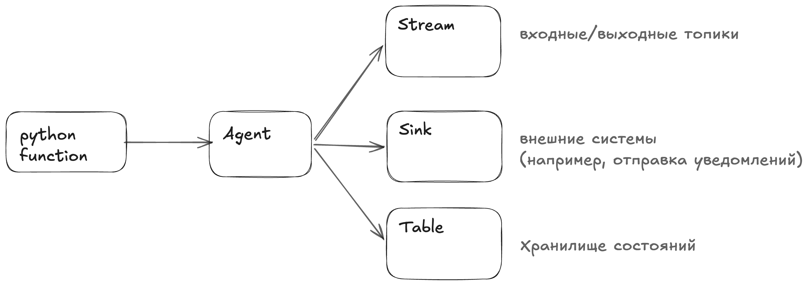
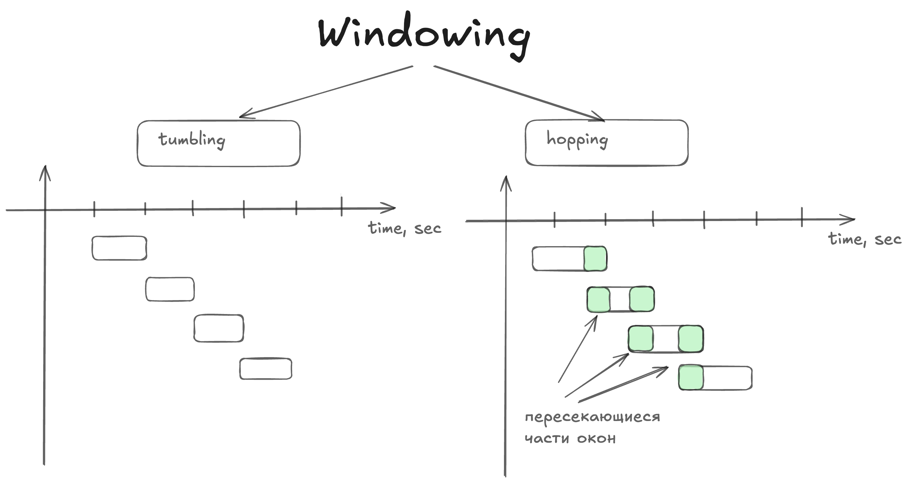

# Потоковая обработка данных с Faust

**Faust** - python библиотека для реализации сложной бизнес логики обработки потоковых данных (поддерживается сохранение состояний)

**kSQLDB** - sql-like инструмент для реализации некоторой логики при обработки потоковых данных

## Архитектура Faust

Основные компоненты:
- Agent - асинхронная функция, которая применятся ко всем полученным сообщениям из топика
- Table - Таблица состояний (хранит последне состояние ключа, которое можно обновить)
- Stream - поток записей, последовательность событий
- Serializer/Deserializer - тулы, позволяющие преобразовывать данные в байты и обратно (поддерживаются различные стандарты: JSON/AVRO и др)

Поддерживает:
- stateless

Без сохранения состояния, например, преобразования форматов

Пример: выявление фрода на лету:

```python
@app.agent(transactions_topic)
async def stateless_process_transactions(stream):
    async for transaction in stream.filter(lambda t: t.amount > 10_000):
        await fraud_detection_topic.send(value=transaction)
```

- statefull

С сохранением состояния, например, вычисления в окне, соединения и др

Подсчет кол-ва транзакций по польвателю (используются Table):

```python
# Таблица для хранения количества транзакций по клиентам
transactions_table = app.Table(
    "transactions-count",
    partitions=1,
    default=int,
)

# Агент для stateful обработки транзакций
@app.agent(transactions_topic)
async def stateful_process_transactions(stream):
    async for transaction in stream:
        transactions_table[transaction.sender_id] += 1
```

С чем взаимодейстуем Agent:




**Stream** - компонент, которые моделирует непрерывный поток событий, поток данных является асинхронным, а его записи обрабатываются последовательно.
Faust взаимодействует с Stream через цикл `for` - это основной способ.

Обработка сообщений двумя способами:
- `stream.items()` - через пары ключ/значение
- `stream.events()` - через сырые сообщения

Подтверждать можно 2 способами:
- автокоммит
- ручной вызов `event.ack()`

Над потоком можно совершать простые операции:
- `group_by`
- `filter`
- `take()` - группировать сообщения перед обработкой 
- объединять топики - `async for value in (stream_1 & stream_2):`

**Table** - таблица состояний, позволяет хранить только 1, последнее значение по ключу (очень похоже на python-словарь)

Используются для statefull операций при агрегировании/подсчетах/контекст обработки данных.
Для обеспечения отказоустойчивости таблица синхронизируется с Kafka через топик изменений (changelog)


### Оконная агрегация (Windowing)

Реализуются две политики:
- фиксированные (статичные, **tumbling**) окна - например, окна, создаваемые каждые 10 сек
- перекрывающиеся окна (**hopping**) - например, 10 секундные окна, создаваемые каждые 5 сек

## Agent

Для задания структуры при отправке/получении событий используем `faust.Record`

```python
import faust

# Описание модели данных
class Transaction(faust.Record):
    sender_id: str
    recipient_id: str
    amount: float


# Входной и выходной топики
transactions_topic = app.topic("transactions", key_type=str, value_type=Transaction)
fraud_detection_topic = app.topic("fraud-detection", key_type=str, value_type=Transaction)
```

### Processors

Что-то похожее на handlers - обработчики сообщений и пересылающие их дальше, передача осуществляется в порядке `как передано пользователем` в блоке
processors при создании объекта `App`.

processor может быть объявлен как синхронная или асинхронная функция.

### Sink

Разделяет логику обработки сообщений от постобработки, позволяет/помогает:
- интегрировать внешние системы
- обмениваться агентам между собой
- повышает читаемость и тестируемость (логичная модульность кода)

Примеры:
- callback function
- kafka topic
- other agants (похоже на TaskFlow Airflow, где выход одной функции автоматически передается на вход другой)


### Local memory

Поддерживается 2 типов:
- inmemory

Дока говорит, что не нужно использовать inmemory в продакшен версиях приложения!

Хранение данных в памяти, доступ быстрый, восстановление долгое, размер не может превышать RAM

Пример конфигурирования:

```python
app = faust.App(
    "persistent-app",
    broker="localhost:9092",
    store="memory://",
)
```

- персистент -> [RockDB](https://rocksdb.org/), [gitlab wiki](https://github.com/facebook/rocksdb/wiki)

Хранение на диске (размер может превышать RAM), доступ средний, восстановление быстрое

Пример конфигурирования:

```python
app = faust.App(
    "persistent-app",
    broker="localhost:9092",
    store="rocksdb://",
)
```

## Что такое Table (detailed)


Создание таблицы - таблица создается в момент объевления в коде:

```python
table = app.Table(
    "table-name",
    partitions=1,    # Количество партиций
    default=int,     # Функция или тип для пропущенных ключей
)
```

Модифицировать данные таблицы можно только из потока, внутри цикла:

```python
async for event in stream:
    # some code below
    table['key'] += 1
```


Итерирование по таблице аналогично итерированию по словарю:

```python
for key, value in table.items():
    print(f"{key}: {value}")
```

### Changelog

Каждое изменение таблицы попадает в специальный топик `changelog`, это позволяет восстановить данные после сбоя, сохранение происходит в 
момент модицифкации таблицы


 ### Windowing

Примеры

**Tumbling (статическое) window**

```python
from datetime import timedelta

windowed_table = app.Table(
    "tumbling-table",
    default=int,
).tumbling(
    timedelta(minutes=1),
    expires=timedelta(hours=1), # - ??
)
```


**Hopping (пересекающееся) window**


```python
from datetime import timedelta

windowed_table = app.Table(
    "hopping-table",
    default=int,
).hopping(
    60,
    30,
    expires=timedelta(hours=1),
    key_index=True
)
```





------


В примере курса использованы `@app.page('/windowed_stats/{user_id}')` - [official docs](https://faust.readthedocs.io/en/latest/userguide/tasks.html#web-views)