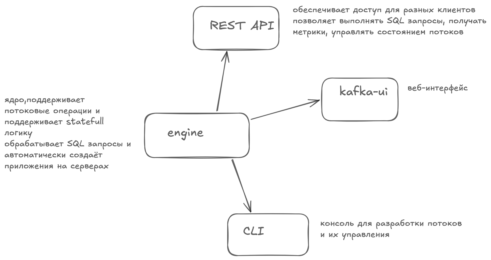
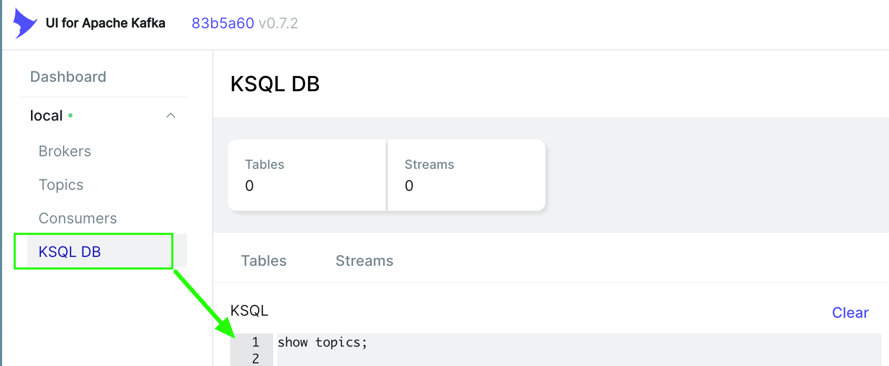
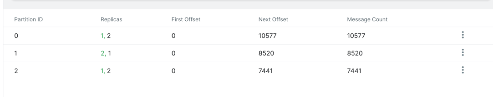
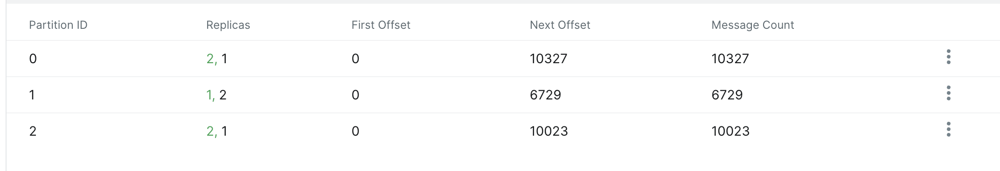

# Потоковая обработка данных: ksql, ksqlDB

- **ksql** - интерфейс для Kafka, чтобы выполнять простые действия
- **ksqlDB** - дальнейшее развитие [ksql](https://www.confluent.io/blog/intro-to-ksqldb-sql-database-streaming/), 
основанное на клиент-серверном подходе, позволяет решать более сложные задачи. Стало системой для потоковой обработки данных, работате на основе KafkaStreams

## Недостатки

- есть ограничения на SQL операции, например, не поддерживаются подзапросы, что может быть критичным при реализации некоторой бизнес-логики
- есть накладные расходы (тк ksqlDB обертка над KafkaStreams, то есть небольшие накладные расходы на взаимодействие)


## Основные компоненты ksqlDB




## Режимы работы

- **adhoc** - обычные SQL запросы, без сохранения состояния, возращают результат сразу пользователю в клиент

```sql
-- Пример интерактивного запроса
SELECT customer_id, product_name, quantity, price
FROM orders_stream
WHERE price > 100
EMIT CHANGES LIMIT 10;
```


```bash
curl --location 'http://localhost:8088/query' \
--header 'Content-Type: application/vnd.ksql.v1+json' \
--data '{
  "ksql": "SELECT customer_id, product_name, quantity, price FROM orders_stream WHERE price > 100 EMIT CHANGES LIMIT 10;"
}'
```

- **persistent queries** - постоянные запросы, которые обновляют данные, работают в фоновом режиме, записывают данные в топики кафка

```sql
-- Пример постоянного запроса
CREATE STREAM high_value_orders AS
    SELECT order_id, customer_id, product_name, price
    FROM orders_stream
    WHERE price > 1000
EMIT CHANGES;
```

## kafka-ui


Для выполнения запросов ksql из UI, необходимо её подключить в конфигурации:

```yaml
  kafka-ui:
    image: provectuslabs/kafka-ui:latest
    container_name: kafka-ui-course
    environment:
      ....
      KAFKA_CLUSTERS_0_KSQLDBSERVER: http://ksqldb-server:8088 # для подключения ksqlDB в UI
```





## Создание потоков в ksqlDB

### Дисклеймер: Два брокера и KSQLDB

В учебной конфигурации запущены два Kafka-брокера. Для работы транзакций KSQLDB
создает системный топик `__transaction_state`, поэтому в
`docker-compose.kafka-ksql.yaml` для обоих брокеров заданы:

```yaml
KAFKA_TRANSACTION_STATE_LOG_REPLICATION_FACTOR: 2
KAFKA_TRANSACTION_STATE_LOG_MIN_ISR: 2
```

Replication factor не может быть больше числа доступных брокеров. После изменения
этих параметров перезапустите брокеры и KSQLDB:

```bash
docker compose -f module-2/t1-l5/docker-compose.kafka-ksql.yaml up -d --force-recreate kafka kafka-broker-2 ksqldb-server
```

Топик `dev.topic.events.v1` уже создан с тремя партициями. При регистрации
существующего топика в KSQLDB укажите то же число:

```sql
CREATE STREAM events__stream (
  user_id STRING,
  event_type STRING,
  timestamp STRING,
  value DOUBLE
) WITH (
  KAFKA_TOPIC = 'dev.topic.events.v1',
  VALUE_FORMAT = 'JSON',
  PARTITIONS = 3
);
```

При выставлении `timestamp TIMESTAMP` - получаю ошибку чтения (понять, как парсить ? или нужна явная схема на топик ?), даты сериализуются как числа
[docs](https://docs.confluent.io/platform/current/ksqldb/reference/serialization.html#timestamp-serialization) или вариант сериализация через SR.

Также новые потоки можно создавать через `create stream <name> as select * from <another-stream>`:

-- покупки
```sql
CREATE STREAM purchase_by_user AS
SELECT *
FROM events__stream
WHERE event_type = 'purchase'
EMIT CHANGES; 
```


### Создание таблиц

Table в ksqlDB является аналогом kTable в KafkaStreams (также хранит последнее состояние данных по ключу):

```sql
CREATE TABLE user_table (
    user_id STRING,
    user_email STRING
) WITH (
    KAFKA_TOPIC = 'table-input-topic',
    VALUE_FORMAT = 'JSON',
    KEY = 'user_id'
);
```

Таблицы использются для агрегатов, например

```sql
CREATE or replace TABLE purchase_by_user
WITH (
  KAFKA_TOPIC = 'PURCHASE_BY_USER',
  VALUE_FORMAT = 'JSON',
  PARTITIONS = 3,
  REPLICAS = 2
) AS
SELECT
  user_id,
  COUNT(*) AS purchases,
  SUM(value) AS total_revenue
FROM events__stream
WHERE event_type = 'purchase'
GROUP BY user_id
EMIT CHANGES;
```

-- события
```sql
CREATE or replace TABLE events_by_user
WITH (
  KAFKA_TOPIC = 'events_by_user',
  VALUE_FORMAT = 'JSON',
  PARTITIONS = 3,
  REPLICAS = 2
) AS
SELECT
  user_id,
  COUNT(*) AS events,
FROM events__stream
GROUP BY user_id
EMIT CHANGES;
```

-- первое событие пользователя
```sql
-- событие
CREATE or replace TABLE first_events_by_user
WITH (
  KAFKA_TOPIC = 'first_events_by_user',
  VALUE_FORMAT = 'JSON',
  PARTITIONS = 3,
  REPLICAS = 2
) AS
SELECT
  user_id,
  min(timestamp) as ts
FROM events__stream
GROUP BY user_id
EMIT CHANGES;

-- покупка
CREATE or replace TABLE first_purchase_by_user
WITH (
  KAFKA_TOPIC = 'first_purchase_by_user',
  VALUE_FORMAT = 'JSON',
  PARTITIONS = 3,
  REPLICAS = 2
) AS
SELECT
  user_id,
  min(timestamp) as ts
FROM events__stream
WHERE event_type = 'purchase'
GROUP BY user_id
EMIT CHANGES;
```

#### qna

При создании таблицы обрабатываются все данные находящиеся в топике/потоке ?

### Удаление


```sql
-- поток
drop stream <stream-name> delete topic;


-- поток c удалением топика
drop stream <stream-name> delete topic;

-- таблица
drop table <table-name>
```

### JOINs

Поддерживаются не все виды JOIN: INNER JOIN, LEFT JOIN и OUTER JOIN.

Сущностей 2: Table and stream, поэтому возожны 3 комбинации:
- stream-table join
- table-table
- stream-stream - наиболее ресурсоемкая операция

Пример:

```sql
select e.user_id
  , e.ts as first_event_ts
  , p.ts as first_purchase_ts
from first_events_by_user e
left join first_purchase_by_user p
on e.user_id = p.user_id
where p.ts is not null
emit changes
limit 10;
```

Все вышесозданные таблицы:

```sql
select e.user_id
  , e.events
  , p.purchases
  , cast(p.purchases as double) / e.events as cr -- классика для Java/C, int/int -> 0
  , fe.ts as first_event_ts
  , fp.ts as first_purchase_ts
from first_events_by_user fe
inner join events_by_user e
on fe.user_id = e.user_id
left join first_purchase_by_user fp
on fe.user_id = fp.user_id
left join purchase_by_user p
on fe.user_id = p.user_id
emit changes
limit 10;
```


### Группировка и агрегирование

Можно использовать задание окна, пример

```sql
CREATE TABLE views_per_region AS
SELECT region_id, COUNT(*) as count
FROM main_video_views
WINDOW TUMBLING (SIZE 1 HOUR) -- откуда считается время ? можно ли его изменить ?
GROUP BY region_id
EMIT CHANGES; -- что делает emit changes ?
```

### repartitioning

Перепартиционирование помогает оптимизировать распределение данных в кластере и в результате повысить производительность и масштабируемость системы

**Пример:**

```sql
CREATE STREAM REPARTITIONED_EVENTS_STREAM 
AS 
SELECT * FROM EVENTS__STREAM
PARTITION BY USER_ID EMIT CHANGES;
```

Есть нюансы:
- перераспределить - буквально будет копия топика с другим распределением
- ключ распределения по дефолту уходить из тела сообщения, пример ниже

```json
# исходное сообщение
{
	"user_id": "user002",
	"event_type": "purchase",
	"timestamp": "2026-10-31T10:28:04.778123",
	"value": 996.8
}

# после перераспределения
{
	"EVENT_TYPE": "purchase",
	"TIMESTAMP": "2026-10-31T17:38:26.270235",
	"VALUE": 456.47
}
```

чтобы оставить ключ в теле сообщения нужен такой синтаксис:

```sql
AS_VALUE(user_id) AS user_id,  -- Сохраняем user_id в теле сообщения 
```


Для полного repartition необходимо действовать из консоли (ksql):

```bash
docker exec -it <имя_контейнера_ksqldb_server> ksql

SET 'auto.offset.reset'='earliest';
CREATE STREAM REPARTITIONED_EVENTS_STREAM 
AS 
SELECT * FROM EVENTS__STREAM
PARTITION BY USER_ID EMIT CHANGES;
```

Распределение сообщений до и после:

ДО:


ПОСЛЕ:
