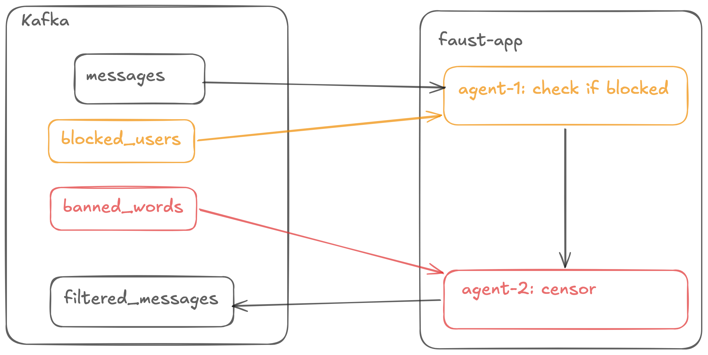

# Разработка упрощённого сервиса обмена сообщениями


**Задача.** 

> Создайте систему обработки потоков сообщений с функциями блокировки пользователей и цензуры сообщений. 
> Разверните систему с использованием Docker-сompose и настройте необходимые топики Kafka. 

## Подзадача 1.  Блокировка нежелательных пользователей

Реализуйте поток обработки сообщений, в котором пользователи смогут блокировать других пользователей. Для этого: 
Создайте отдельный список заблокированных для каждого пользователя.
Этот список должен храниться в персистентном хранилище:
> Java: persistent state store 
> 
> Python: table 
> 
> Go: group table

Реализуйте автоматическую фильтрацию: сообщения от нежелательных пользователей не должны доходить до получателей. 

## Подзадача 2. Цензура на слова

Создайте список запрещённых слов, который можно динамически обновлять.
Добавьте компонент, обрабатывающий поток сообщений и удаляющий или маскирующий запрещённые слова.
Все сообщения должны проходить через цензуру перед отправкой получателю.

## Инфраструктура

Используйте Docker-сompose для развёртывания.

Подготовьте топики Kafka:
> messages ― входящие сообщения
> 
> filtered_messages ― сообщения после обработки
> 
> blocked_users ― данные о заблокированных пользователях.

Тестирование. Создайте тестовые данные для проверки блокировки и цензуры сообщений в топиках.
Инструменты. 

Язык: Python (Faust).
Библиотеки: Kafka Streams, Faust или Goka.

## Архитектура

Всё живёт в одном Faust-приложении (`message-processor`): три агента и две таблицы состояния.




## Структура

```
.
├── README.md
├── docker-compose.kafka.yaml
├── test.sh
└── docker
    └── message-processor
        ├── Dockerfile
        ├── message_processor.py
        └── requirements.txt
```

# How to

1. Где бы ты ни был, погрузись в терминале в папку `t1-practice`

```bash
cd <your-folder-with-git-project>/course-kafka-arch-and-dev/module-2/t1-practice
```

2. Поднимаем стэк

```bash
docker compose -f docker-compose.kafka.yaml up -d
```

Когда `message-processor` в статусе `Up`, в его логах будет `Worker ready`:

```bash
docker logs -f message-processor
```

3. Kafka-UI ждёт на http://127.0.0.1:8080.

Готово, можно тестировать (см. ниже).

Остановить и удалить всё (включая данные и volume):

```bash
docker compose -f docker-compose.kafka.yaml down -v
```

## Контракты сообщений

**`messages`** (key = `to_user_id`):

```json
{
  "message_id": 1,
  "from_user_id": "user_01",
  "to_user_id": "user_02",
  "text": "hello user_02",
  "timestamp": "2026-11-07T10:00:00"
}
```

**`blocked_users`** (key = `from_user_id` — у кого хранится список):

```json
{
  "from_user_id": "user_02",
  "blocked_user_id": "user_01",
  "is_blocked": 1
}
```

`is_blocked`: 1 — заблокировать, 0 — разблокировать.

**`banned_words`** (key = `word`):

```json
{
  "word": "spam",
  "is_banned": 1
}
```

`is_banned`: 1 — забанить, 0 — разбанить.

**`filtered_messages`** — те же `Message`, что в `messages`, но text уже прошёл цензуру.
Примечание: faust добавляет в сериализуемый JSON служебное поле `__faust` (namespace модели) —
это нормально, так сериализуются faust-модели.

## Приложение: message_processor.py

### Классы (контракты)

- `Message` — сообщение чата: `message_id: int`, `from_user_id`, `to_user_id`, `text`, `timestamp`
- `BlockEvent` — событие блокировки: `from_user_id` (блокировщик), `blocked_user_id`, `is_blocked: 0/1`
- `BannedWordEvent` — событие бана слова: `word`, `is_banned: 0/1`

Все три — `faust.Record` (сериализуются в JSON, описаны в контрактах выше).

### Таблицы состояния

- `blocked` — списки заблокированных: key = пользователь-блокировщик, value = список заблокированных `user_id`
- `banned_words` — запрещённые слова: key = слово, value = `is_banned` (0/1)

Таблицы создаются с `default` (`list` / `int`) — пропущенный ключ возвращает пустой список / 0.
`value_type` на таблицы **не** задаём: встроенные типы (`list`, `int`) не имеют `from_data()`
и ломают десериализацию changelog в faust 0.13.0, без `value_type` значения ходят как JSON.

Каждая таблица синхронизируется со своим changelog-топиком
(`message-processor.blocked-changelog`, `message-processor.banned_words-changelog`) —
видны в Kafka-UI, используются faust для восстановления состояния после сбоя.

### Агенты

**`process_block_events`** (читает `blocked_users`): поддерживает списки блокировок.
`is_blocked=1` — добавляет `blocked_user_id` в список `from_user_id` (если ещё нет),
`is_blocked=0` — убирает (если есть). После каждого события список перезаписывается в таблицу
(запись уходит в changelog).

**`process_banned_words`** (читает `banned_words`): пишет `is_banned` в таблицу
`banned_words` по ключу `word`.

**`process_messages`** (читает `messages`) — сам конвейер:

1. **Блокировка.** Получатель (`to_user_id`) заблокировал отправителя (`from_user_id`)?
   Да — сообщение отбрасывается (в лог уходит WARNING), до получателя не доходит.
2. **Цензура.** Берём текущий список запрещённых слов из таблицы
   (все слова с `is_banned=1`) и маскируем их в тексте.
3. **Пересылка.** Обработанное сообщение уходит в `filtered_messages` с ключом `to_user_id`.

### Цензура

```python
def censor(text: str, banned: list) -> str:
    for word in banned:
        regex = re.compile(re.escape(word), re.IGNORECASE)
        text = regex.sub(lambda m: "*" * len(m.group()), text)
    return text
```

Сделано просто и со вкусом =) (выбрали маскирование):
маска `*` по длине вхождения, без учёта регистра, по всему тексту. Пунктуация вокруг слова
сохраняется («SPAM.» → «****.»)

# Тестирование

1. Все топики пустые

При отправке сообщения топик `messages` оно в исходном виде будет в топике `filtered_messages`:

```json
{"message_id": 1, "from_user_id": "user_01", "to_user_id": "user_02", "text": "I am a message for passthrough!", "timestamp": "2026-11-07T10:00:00"}
```

2. Добавляем заблокированного пользователя

```json
{"from_user_id": "user_02", "blocked_user_id": "user_01", "is_blocked": 1}
```

При отправке сообщения топик `messages` оно в не появиться в топике `filtered_messages`:

```json
{"message_id": 1, "from_user_id": "user_01", "to_user_id": "user_02", "text": "I am a blocked message!", "timestamp": "2026-11-07T10:00:00"}
```

3. Цензура без цензуры

При пустом `banned_words` при отправке сообщения в топик `messages` оно появиться в топике `filtered_messages`:

```json
{"message_id": 1, "from_user_id": "user_01", "to_user_id": "user_03", "text": "I am a SPAM message!", "timestamp": "2026-11-07T10:00:00"}
```

4. Цензура

Обновляем данные в топике `banned_words`:

```json
{"word": "spam", "is_banned": 1}
```

При отправке сообщения в топик `messages` оно появиться в топике `filtered_messages` с маскированием:

```json
{"message_id": 1, "from_user_id": "user_01", "to_user_id": "user_03", "text": "I am a **** message!", "timestamp": "2026-11-07T10:00:00"}
```

5. Проверка восстановления топиков `banned_words/blocked_users` после рестарта

Выполни в терминале `docker restart message-processor`

В логах `[2026-11-07 09:00:01,479] [1] [INFO] [^---Recovery]: Restore complete! `), проверить:
- в volume контейнера должны быть файлы

```bash
docker exec -it message-processor /bin/bash
root@5899ebf25bc8:/app# cd data/v1/tables/
root@5899ebf25bc8:/app/data/v1/tables# ls -lah
total 40K
drwxr-xr-x 10 root root 4.0K Nov  7 09:45 .
drwxr-xr-x  3 root root 4.0K Nov  7 09:45 ..
drwxr-xr-x  2 root root 4.0K Nov  7 09:45 banned_words-0.db
drwxr-xr-x  2 root root 4.0K Nov  7 09:45 banned_words-1.db
drwxr-xr-x  2 root root 4.0K Nov  7 09:45 banned_words-2.db
drwxr-xr-x  2 root root 4.0K Nov  7 09:45 banned_words-backups
drwxr-xr-x  2 root root 4.0K Nov  7 09:45 blocked-0.db
drwxr-xr-x  2 root root 4.0K Nov  7 09:45 blocked-1.db
drwxr-xr-x  2 root root 4.0K Nov  7 09:45 blocked-2.db
drwxr-xr-x  2 root root 4.0K Nov  7 09:45 blocked-backups
```


### Вопрос 1

> Хочу реализовать join таблицы blocked_users с топиком, не понятно как ?
> в целом что эффективнее/корректнее: получать инфу по ключу или join ?
> 
> Есть предположение, что join тоже будет что-то типа hash
> 
