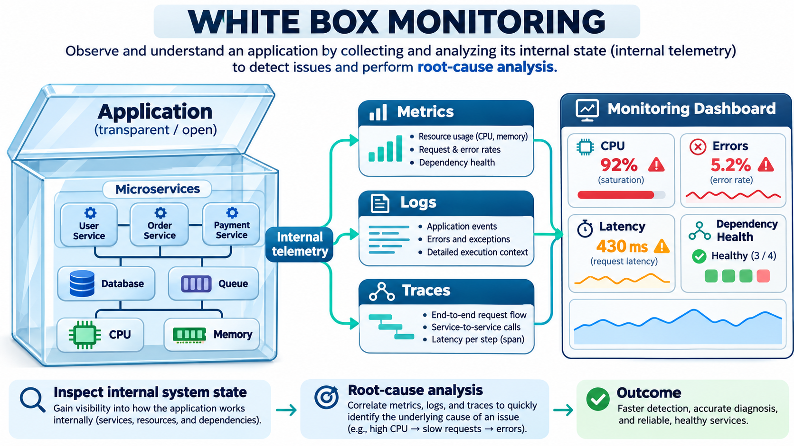

# Мониторинг

Мониторинг строится слоями:

## Бизнес-слой: **«Что видит пользователь?»**

- сколько заказов/транзакций за единицу времени
- время от старта заказа до его финализации
- уровень ошибок по бизнес-логике

Для этого лучше использовать отдельный топик с агрегацией или использовать Micrometer/StatsD/Prometheus с добавлением
метрик ручками

## Прикладной уровень: **«Как работает наше приложение?»**

- кол-во HTTP запросов
- частота 5xx ошибок
- размеры буферов продьюсеров
- длина очередей, переполнение потоков
- лаги консьюмеров

## инфра: **«Жива ли сама платформа?»**

ресурсы, сетевые и аппаратные характеристики

- CPU/RAM, disk usage
- использование файловых дискрипторов
- кол-во ISR
- отставание реплик
- кол-во --under-replicated-partitions
- объем траффика и др

> **Рекомендация:** используйте JMX Exporter + Prometheus для сбора этих метрик. Kafka по умолчанию экспортирует их через JMX.

В качестве подходов к мониторингу используют: Blackbox, Whitebox

## Blackbox

Мониторинг проверяет систему снаружи, например:
- HTTP healthcheck
- ICMP ping
- kafka.log не обновлялся более 5 минут
- CPU > 90%

Получение первых симптомов

[Blackbox exporter by Graphana](https://grafana.com/grafana/dashboards/18896-blackbox-exporter/)

## Whitebox

Мониторинг системы изнутри, система сама публикует их через метрики/логи/трейсы, используются Prometheus, Grafana, OpenTelemetry, Micrometer

Примеры:
- kafka_server_ReplicaManager_UnderReplicatedPartitions > 0
- jvm_gc_pause_seconds > 1
- replica_lag

Практики SRE (Site Reliability Engineer) позволяют объединить оба подхода:

SRE-инженеры ориентируются не только на uptime, но и на метрики SLO/SLA/SLI:
- **SLO** — целевой уровень (например, 99.9 % ответов за < 500 мс);
- **SLA** — юридически закреплённый уровень;
- **SLI** — фактические метрики (latency, errors, throughput).

Про SRE:
- [Кто такой SRE специалист](https://slurm.io/blog/sre-inzhener-kto-ehto-i-kakie-zadachi-reshaet)
- [thecodemedia](https://thecode.media/chto-takoe-sre/)
- [Site Reliability Engineering. Надежность и безотказность как в Google](https://www.litres.ru/book/betsi-beyer-17338311/site-reliability-engineering-nadezhnost-i-bezotkaznos-39123367/)

Соглсано книге Site Reliability Engineering в начале стоит озаботиться мониторингом 4 китов:
- задержка (latency)
- трафик (traffic)
- ошибки (errors)
- загруженность (saturation)

Экосистемы мониторинга:
- Zabbix (server + proxy + agent, push model)
- Prometheus (server + time-series db + alertmanager + exporters, pull model)

-----------

⏩ [Main](https://github.com/urevoleg/course-kafka-arch-and-dev)

⏩ [Current module](https://github.com/urevoleg/course-kafka-arch-and-dev/tree/main/module-3)